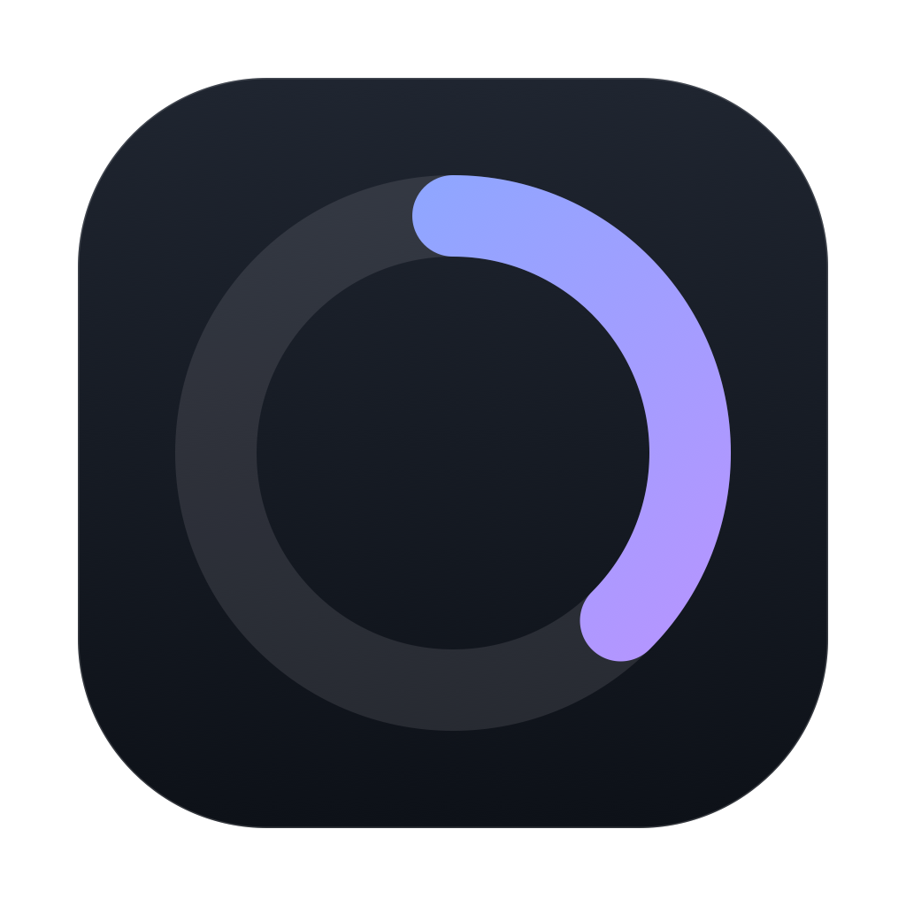

<div align="center">



# DeepSeek Meter

**Your DeepSeek balance and token burn, always one glance away.**

A tiny always-on-top pill for macOS that shows what is left in your account and how hard you are currently driving it.

[](https://github.com/AMBR0SI0/DeepSeekMeter/actions/workflows/ci.yml)


</div>

---

| Resting | Compact | Full report |
| :-: | :-: | :-: |
|  |  |  |
| Balance, a status orb, and a load hairline | 1 min · 10 min · 1 hour, plus a sparkline | Balance, windows, 60-minute chart, daily report |

## Why this exists

If you drive Claude Code through DeepSeek's Anthropic-compatible endpoint, you are paying per token — but there is nothing on screen telling you how fast you are burning the account. DeepSeek's API can tell you your **balance** (`GET /user/balance`); it has **no per-key usage endpoint**. So this app pairs the live balance with usage it derives from your own Claude Code transcripts.

The result is a HUD you can leave running all day: quiet when you are thinking, amber when you are pushing, red when you are about to regret that 200k-token context.

## Install

**Requirements:** macOS 14 (Sonoma) or later, Apple silicon or Intel, and the Xcode Command Line Tools.

```bash
xcode-select --install          # once, if you don't have them
git clone https://github.com/AMBR0SI0/DeepSeekMeter.git
cd DeepSeekMeter
./install.sh
```

`install.sh` builds a universal binary, wraps it in `DeepSeekMeter.app`, copies it to `/Applications` (falling back to `~/Applications` if that is not writable), and launches it. It lives in the menu bar — no Dock icon.

### Manual build

```bash
./build.sh                      # universal (arm64 + x86_64), then:
open DeepSeekMeter.app
```

Use `./build.sh --native` to build only for the machine you are on, which is faster.

### Launch at login

There is no installer daemon. Add the app once under **System Settings → General → Login Items → Open at Login**, and it will be there every morning.

### Uninstall

Quit from the menu bar, delete `DeepSeekMeter.app`, and remove the data folder:

```bash
rm -rf ~/Library/Application\ Support/DeepSeekMeter
```

## Set up your key

The app reads your DeepSeek API key from the first of these that exists:

1. The `DEEPSEEK_API_KEY` environment variable — set it in your shell if you launch the app from there, or use a launch agent.
2. `~/.claude/settings.json` → `env.ANTHROPIC_AUTH_TOKEN`, which is where Claude Code keeps it when configured for DeepSeek.

That second path is the one most people already have:

```json
{
  "env": {
    "ANTHROPIC_BASE_URL": "https://api.deepseek.com/anthropic",
    "ANTHROPIC_AUTH_TOKEN": "sk-..."
  }
}
```

The key is read **on each balance refresh and never written anywhere** — it is not copied into this app's state file, not logged, and not sent anywhere except `api.deepseek.com`.

No key yet? Open the menu bar item → **Open Data Folder** to find the state directory, and see [Configuration](#configuration).

## Use it

| Action | What happens |
| --- | --- |
| Click the pill | Opens the compact card: 1 min / 10 min / 1 hour windows and a 44-bar sparkline |
| Click the compact card (or ⌃) | Opens the full report; click ⌄ to go back |
| Drag the widget | Moves it in any state. Dropped near a side it settles against that edge, and it always stays fully on screen, above the Dock |
| Click − on either card | Collapses back to the pill |
| Click a day row | Reveals input / output / cache-hit and observed spend for that day |
| Menu bar icon | Show Meter · Expand Meter · Reset Position · Open Data Folder · Refresh Now · Quit |

The pill is a non-activating HUD: it floats above other windows on every Space and full-screen app, and it never steals keyboard focus from whatever you are typing in.

### What the states mean

| State | Meaning |
| --- | --- |
| **Idle** grey | Almost no traffic in the last ten minutes |
| **Normal** green | Request rate is healthy but under the warn line |
| **Elevated** amber | The busiest window crossed its warn threshold |
| **High** red | A window crossed its red threshold — the pill also gets a red glow |

The overall state is the worst of the three windows, so one hot minute is enough to turn the pill red. The idle pill shows a 2 px load hairline along its bottom edge, scaled against the red thresholds.

## Configuration

Thresholds are optional. Create `config.json` next to the app's state file:

```
~/Library/Application Support/DeepSeekMeter/config.json
```

```json
{
  "thresholds": {
    "warn1m": 500000,
    "red1m": 1000000,
    "warn10m": 3000000,
    "red10m": 6000000,
    "warn1h": 10000000,
    "red1h": 20000000,
    "idleBelow": 50000
  }
}
```

Every field is optional; anything you leave out keeps its default. Values are **tokens**, summed across input, output, cache reads and cache writes. The file is read at launch, so quit and relaunch after editing. If the file does not exist, the thresholds last saved in `state.json` are used.

| Variable | Default | Purpose |
| --- | --- | --- |
| `DEEPSEEK_API_KEY` | — | API key; wins over the Claude Code settings file |
| `DEEPSEEKMETER_TRANSCRIPTS` | `~/.claude/projects` | Where to look for Claude Code `.jsonl` transcripts |

## How it works

Two independent loops, both local-first:

**Balance** — `GET https://api.deepseek.com/user/balance` once a minute. The response's `total_balance` is what the pill shows, and a drop observed across two readings less than 15 minutes apart is attributed to today's spend. A rise is treated as a top-up, not negative spend.

**Usage** — every 4 seconds the app walks `~/.claude/projects/**/*.jsonl` and reads only the bytes appended since the last pass, so a rescan of a large transcript directory costs almost nothing. Each response is counted once, keyed by `message.id` (Claude Code writes the same record several times), then bucketed by minute in *local* time.

```
~/.claude/projects/**/*.jsonl ──▶ incremental reader ──▶ dedupe by message.id
                                                             │
                                          minute buckets ◀───┘
                                                │
                           1m / 10m / 1h windows, sparkline, daily report
```

Only responses carry usage, so system lines, summaries and malformed JSON are skipped silently. Old data is pruned: **3 days** of minute detail, **30 days** of daily summaries, with model breakdowns trimmed to the top three after three days.

State lives in `~/Library/Application Support/DeepSeekMeter/state.json` and is written atomically. It is rewritten only when a scan actually ingests something or pruning changes state — not every 4 seconds.

## Privacy

- Everything stays on your machine except the balance request to `api.deepseek.com`.
- No telemetry, no analytics, no crash reporting, no auto-update.
- Your API key is never persisted by this app and never leaves the process except in the `Authorization` header of that one request.
- Transcripts are read, never modified.

## Development

```bash
swift build            # debug
swift test             # 23 tests
./build.sh             # .app bundle, universal
```

Regenerate the screenshots in `docs/screenshots/` with deterministic demo data:

```bash
swift run DeepSeekMeter --snapshot
```

The icon is generated, not hand-drawn:

```bash
swift Scripts/make-icon.swift        # writes docs/icon.png and Resources/AppIcon.icns
```

### Layout

```
Sources/DeepSeekMeter/
  App.swift      MenuBarExtra, the NSPanel HUD, dragging, geometry
  Data.swift     transcript scanner, DeepSeek client, observable store
  Models.swift   balance, day records, thresholds, clock keys, formatting
  Design.swift   palette, glass card, orb, gauges, bar chart, typography
  Views.swift    idle / compact / expanded layouts
Tests/…          formatting, clock, levels, parsing, windows, config
```

## Limitations

- **macOS 14+ only.** The widget is AppKit + SwiftUI; there is no Linux or Windows build, and no plans for one.
- **Usage comes from Claude Code transcripts.** Calls you make from other tools (curl, other SDKs, other editors) still move the balance, but they will not appear in the token windows.
- **Spend today is observed spend.** It is the sum of balance drops the app actually saw while running, not a server-side ledger.
- The thresholds are heuristics tuned for a single daily driver. Everyone's comfortable rate is different — that is what `config.json` is for.
- The app is ad-hoc signed, not notarized. Built locally, it just runs.

## Contributing

Bug reports and patches are welcome — see [CONTRIBUTING.md](CONTRIBUTING.md). Keep it small, keep it native, and run `swift test` before opening a PR.

## License

[MIT](LICENSE)
