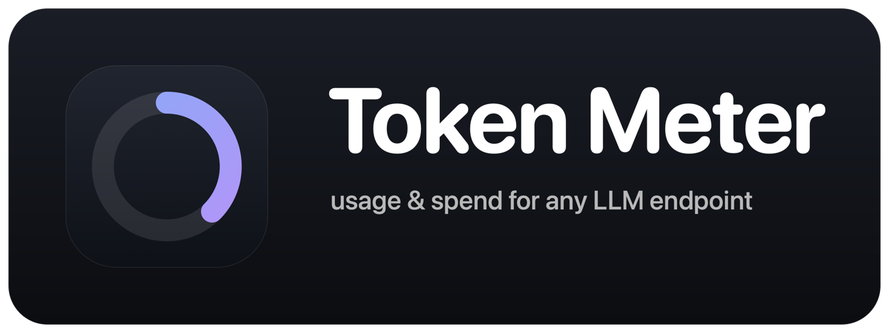
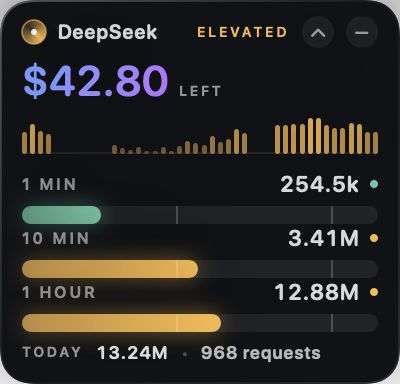
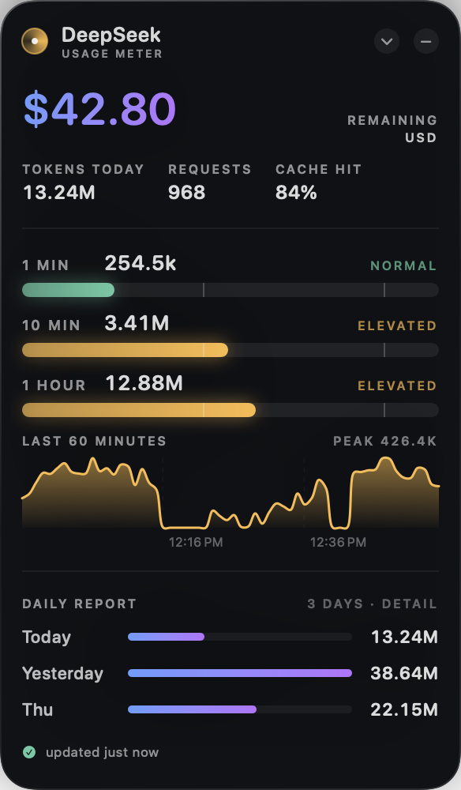

<div align="center">



**Your LLM spend, always one glance away.**

A tiny always-on-top pill for macOS that shows what is left in your account, how fast you are burning it, and what each day cost you.


</div>

---

| Resting | Compact | Full report |
| :-: | :-: | :-: |
|  |  |  |
| Balance, a status orb, and a load hairline | 1 min · 10 min · 1 hour, plus a sparkline | Balance, windows, 60-minute chart, daily report with spend |

## Why this exists

Claude Code can run against any Anthropic-compatible endpoint — DeepSeek, OpenRouter, Moonshot, GLM, a local gateway. Most of them bill per token, and none of them put a meter on your screen. You find out what the day cost when the balance runs out.

Token Meter is that meter. It reads **balance** from the provider's API when one exists, **usage** from your own Claude Code transcripts (which are provider-independent), and **spend** from a price table you can edit. It is quiet when you are thinking, amber when you are pushing, red when you are about to regret that 200k-token context.

## Works with any provider

Usage is the same everywhere: every provider on the Anthropic-compatible API records `input_tokens`, `output_tokens`, `cache_read_input_tokens` and `model` in the transcript. Only **balance** and **price** differ, so those are the only things a provider definition has to describe.

On first launch Token Meter reads `ANTHROPIC_BASE_URL` (from your environment or `~/.claude/settings.json`) and picks a preset:

| Provider | Detected from | Balance shown | Prices included |
| --- | --- | --- | --- |
| **DeepSeek** | `api.deepseek.com` | Remaining balance (USD/CNY) | Yes, with peak/off-peak schedule |
| **OpenRouter** | `openrouter.ai` | Credits minus usage | No — add yours |
| **Moonshot** | `api.moonshot.cn` / `api.moonshot.ai` | Remaining balance (CNY/USD) | No — add yours |
| **Anything else** | any other base URL | None — shows today's spend instead | No — add yours |

Any preset can be overridden, and a provider with no balance endpoint still gets the live windows, the chart and the daily spend. A new provider is a JSON block, not a code change — see [Configuration](#configuration).

## Install

**Requirements:** macOS 14 (Sonoma) or later, Apple silicon or Intel, and the Xcode Command Line Tools.

```bash
xcode-select --install          # once, if you don't have them
git clone https://github.com/AMBR0SI0/token-meter.git
cd token-meter
./install.sh
```

`install.sh` builds a universal binary, wraps it in `TokenMeter.app`, copies it to `/Applications` (falling back to `~/Applications` if that is not writable), and launches it. It lives in the menu bar — no Dock icon.

### Build it yourself

```bash
./build.sh                      # universal (arm64 + x86_64), then:
open TokenMeter.app
```

Use `./build.sh --native` to build only for the machine you are on, which is faster. `swift run TokenMeter` runs a debug build straight out of `Sources/`.

### Launch at login

There is no installer daemon. Add the app once under **System Settings → General → Login Items → Open at Login**, and it will be there every morning.

### Uninstall

Quit from the menu bar, delete `TokenMeter.app`, and remove the data folder:

```bash
rm -rf ~/Library/Application\ Support/TokenMeter
```

## Set up your key

Token Meter resolves the key on every refresh, first match wins:

1. **`TOKENMETER_API_KEY`** — a generic override, useful for a provider that has no preset.
2. **The provider's own variable** — `DEEPSEEK_API_KEY`, `OPENROUTER_API_KEY` or `MOONSHOT_API_KEY`.
3. **`~/.claude/settings.json` → `env.ANTHROPIC_AUTH_TOKEN`** — the path most people already have, because that is where Claude Code keeps the key for the endpoint it uses.

That settings file usually looks like this:

```json
{
  "env": {
    "ANTHROPIC_BASE_URL": "https://api.deepseek.com/anthropic",
    "ANTHROPIC_AUTH_TOKEN": "sk-..."
  }
}
```

Nothing is written to disk. The key is not copied into the app's state file, not logged, and not sent anywhere except the balance endpoint of the provider you configured. A provider with no balance endpoint never reads the key at all.

## Use it

| Action | What happens |
| --- | --- |
| Click the pill | Opens the compact card: 1 min / 10 min / 1 hour windows and a 44-bar sparkline |
| Click the compact card (or ⌃) | Opens the full report; click ⌄ to go back |
| Drag the widget | Moves it in any state. Dropped near a side it settles against that edge, and it always stays fully on screen, above the Dock |
| Click − on either card | Collapses back to the pill |
| Click a day row | Reveals input / output / cache-hit and spend for that day |
| Menu bar icon | Show Meter · Expand Meter · Reset Position · Edit Configuration… · Reload Configuration · Open Data Folder · Refresh Now · Quit |

The pill is a non-activating HUD: it floats above other windows on every Space and full-screen app, and it never steals keyboard focus from whatever you are typing in.

### Reading the numbers

- **The big figure** is your remaining balance when the provider reports one, and today's estimated spend otherwise. The label underneath says which.
- **Tokens today** sums input, output, cache reads and cache writes.
- **Spent today** is the price-table estimate for everything recorded today. A `~` means some of those tokens had no matching price, so the figure is a floor. A `—` means nothing today was priced.
- **Daily report** shows the configured number of days, newest first; the header says how many. Days with no traffic show zero tokens and no spend.
- **Cache hit** is cache reads ÷ (cache reads + cache writes + input), the share of prompt tokens served from cache.

### What the states mean

| State | Meaning |
| --- | --- |
| **Idle** grey | Almost no traffic in the last ten minutes |
| **Normal** green | Request rate is healthy but under the warn line |
| **Elevated** amber | The busiest window crossed its warn threshold |
| **High** red | A window crossed its red threshold — the pill also gets a red glow |

The overall state is the worst of the three windows, so one hot minute is enough to turn the pill red. The idle pill shows a 2 px load hairline along its bottom edge, scaled against the red thresholds.

## Configuration

Everything optional lives in one file:

```
~/Library/Application Support/TokenMeter/config.json
```

Create it from the menu: **Edit Configuration…** writes a template matching your detected provider and opens it. After editing, choose **Reload Configuration** — no relaunch needed. Every field is optional, and anything you leave out keeps the preset (or the default).

### A complete example

```json
{
  "provider": {
    "name": "GLM",
    "key": { "env": "ZHIPU_API_KEY" },
    "balance": null
  },
  "pricing": {
    "currency": "USD",
    "models": {
      "glm-4.6": { "input": 0.60, "output": 2.20, "cacheRead": 0.11, "cacheWrite": 0.60 }
    },
    "fallback": { "input": 0.60, "output": 2.20 }
  },
  "historyDays": 14,
  "thresholds": {
    "warn1m": 500000,
    "red1m": 1000000,
    "warn10m": 3000000,
    "red10m": 6000000,
    "warn1h": 10000000,
    "red1h": 20000000,
    "idleBelow": 50000
  }
}
```

### `provider`

| Field | Meaning |
| --- | --- |
| `name` | What the header shows |
| `key.env` | Environment variable holding the key |
| `key.file` + `key.jsonPath` | Read the key from a file, optionally at a dot path (`~/` is expanded) |
| `balance` | How to fetch the balance; omit to keep the preset's endpoint, or set `null` to disable it |

A `balance` block describes one HTTP call:

```json
{
  "url": "https://api.example.com/v1/credits",
  "method": "GET",
  "headers": { "Authorization": "Bearer {key}" },
  "valuePath": "data.total_credits",
  "subtractPath": "data.total_usage",
  "currencyPath": "data.currency",
  "currency": "USD"
}
```

`valuePath`, `subtractPath` and `currencyPath` are dot paths into the JSON response; array indexes are numeric (`balance_infos.0.total_balance`). `{key}` in a header is replaced with the resolved key. `subtractPath` handles providers that report credits and usage separately, as OpenRouter does. If the call fails, the widget keeps showing the last known balance and puts the error in the footer.

### `pricing`

Rates are in `currency` **per million tokens**.

| Field | Meaning |
| --- | --- |
| `currency` | Symbol and unit for every spend figure (default `USD`) |
| `models` | Map of model id → `{ input, output, cacheRead, cacheWrite }` |
| `fallback` | Rates for models with no entry; without it, unpriced models are left out of spend |
| `schedule` | Optional peak pricing: `peakHoursUTC` (list of `[start, end)` hours), `peakMultiplier`, `weekdaysOnly` |

Model matching is exact first, then the longest key contained in the transcript's model id, so `glm-4.6` also prices `z-ai/glm-4.6`. Your entries are merged over the preset, so adding one model keeps every other preset price.

The DeepSeek preset ships its published off-peak rates and its peak schedule (×2 on weekdays 01:00–04:00 and 06:00–10:00 UTC). Providers change prices more often than this app ships releases — if a number looks wrong, override it here.

### `historyDays`

How many days the report shows, clamped to **3–30**, default **7**. Daily summaries are kept for at least 30 days, so raising this later brings old days back into view.

### `thresholds`

Values are **tokens**, summed across input, output, cache reads and cache writes. Omit the block to keep the defaults.

### Environment variables

| Variable | Default | Purpose |
| --- | --- | --- |
| `TOKENMETER_API_KEY` | — | Key override; wins over every provider variable |
| `TOKENMETER_BASE_URL` | — | Provider detection when `ANTHROPIC_BASE_URL` is not set |
| `TOKENMETER_TRANSCRIPTS` | `~/.claude/projects` | Where to look for Claude Code `.jsonl` transcripts |

## How it works

Two independent loops, both local-first:

**Balance** — one request to the configured endpoint per minute. The value is what the pill shows. A drop observed across two readings less than 15 minutes apart is recorded as spend; a rise is treated as a top-up, not negative spend.

**Usage** — every 4 seconds the app walks `~/.claude/projects/**/*.jsonl` and reads only the bytes appended since the last pass, so a rescan of a large transcript directory costs almost nothing. Each response is counted once, keyed by `message.id` (Claude Code writes the same record several times), priced from the table, then bucketed by minute in *local* time.

```
~/.claude/projects/**/*.jsonl ──▶ incremental reader ──▶ dedupe by message.id
                                                             │
                                       ┌─────────────────────┴──────────────┐
                                 minute buckets                       price table
                                       │                                    │
                     1m / 10m / 1h windows, sparkline,          spend per day
                     chart, daily report
```

Only responses carry usage, so system lines, summaries and malformed JSON are skipped silently. Old data is pruned: **3 days** of minute detail, **30 days** (or `historyDays`, whichever is larger) of daily summaries, with model breakdowns trimmed to the top three after three days.

State lives in `~/Library/Application Support/TokenMeter/state.json` and is written atomically. It is rewritten only when a scan actually ingests something or pruning changes state — not every 4 seconds. Renaming from the old DeepSeek Meter copies `state.json` and `config.json` across on first launch, so history survives the upgrade.

## Privacy

- Everything stays on your machine except the balance request to the endpoint you configured.
- No telemetry, no analytics, no crash reporting, no auto-update.
- Your API key is never persisted by this app and never leaves the process except in the header of that one request.
- Transcripts are read, never modified.

## Development

```bash
swift build            # debug
swift test             # 47 tests
./build.sh             # .app bundle, universal
```

Regenerate the screenshots in `docs/screenshots/` with deterministic demo data:

```bash
swift run TokenMeter --snapshot
```

The icon and the README logo are generated, not hand-drawn:

```bash
swift Scripts/make-icon.swift        # writes docs/icon.png and Resources/AppIcon.icns
swift Scripts/make-logo.swift        # writes docs/logo.png from the icon
```

### Layout

```
Sources/TokenMeter/
  App.swift      MenuBarExtra, the NSPanel HUD, dragging, geometry, snapshots
  Data.swift     transcript scanner, observable store, persistence, config
  Provider.swift key resolution, balance endpoint spec, presets, HTTP call
  Pricing.swift  per-model rates, peak schedule, cost math
  Models.swift   balance, day records, thresholds, clock keys, formatting
  Design.swift   palette, glass card, orb, gauges, bar chart, typography
  Views.swift    idle / compact / expanded layouts
Tests/…          formatting, clock, levels, parsing, pricing, providers, config
```

## Limitations

- **macOS 14+ only.** The widget is AppKit + SwiftUI; there is no Linux or Windows build, and no plans for one.
- **Usage comes from Claude Code transcripts.** Calls you make from other tools (curl, other SDKs, other editors) still move the balance, but they will not appear in the token windows.
- **Spend is an estimate, not a ledger.** It prices the tokens your transcripts record. Providers bill rounding, minimums and price changes that a local table cannot see; the balance is the authority. Days where some tokens had no price are marked with `~`.
- **Cache fields can be zero behind a gateway.** Some proxies strip `cache_read_input_tokens`; the cache figure then reads lower than the provider's own dashboard.
- The thresholds are heuristics tuned for a single daily driver. Everyone's comfortable rate is different — that is what `config.json` is for.
- The app is ad-hoc signed, not notarized. Built locally, it just runs.

## Contributing

Bug reports and patches are welcome — see [CONTRIBUTING.md](CONTRIBUTING.md). New provider presets and price tables are especially useful, since they are data, not code. Keep it small, keep it native, and run `swift test` before opening a PR.

## License

[MIT](LICENSE)
